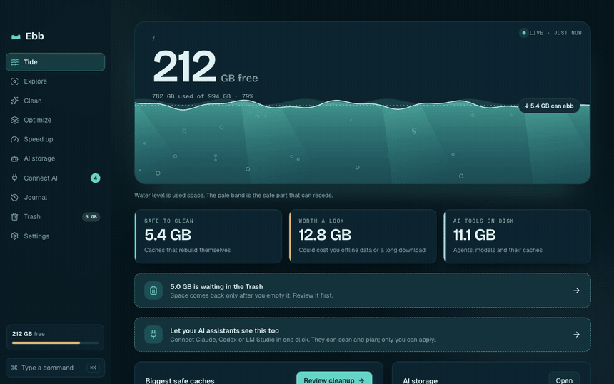
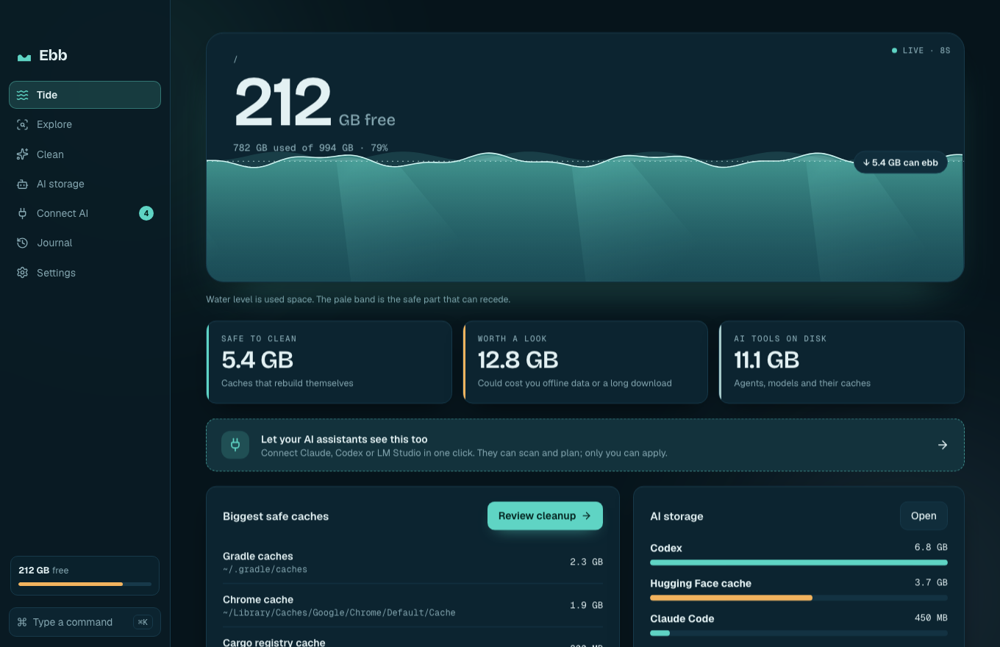
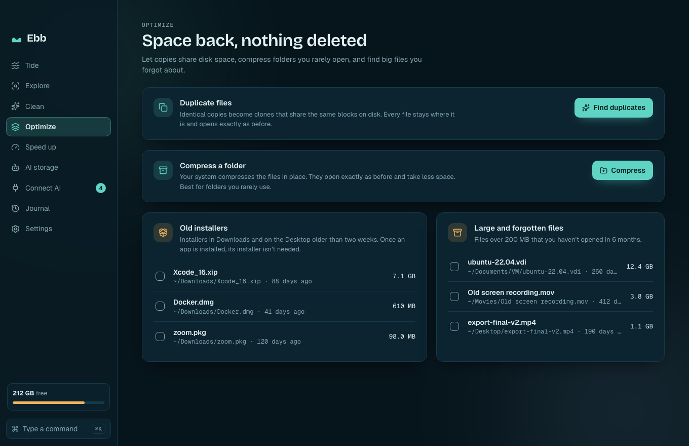
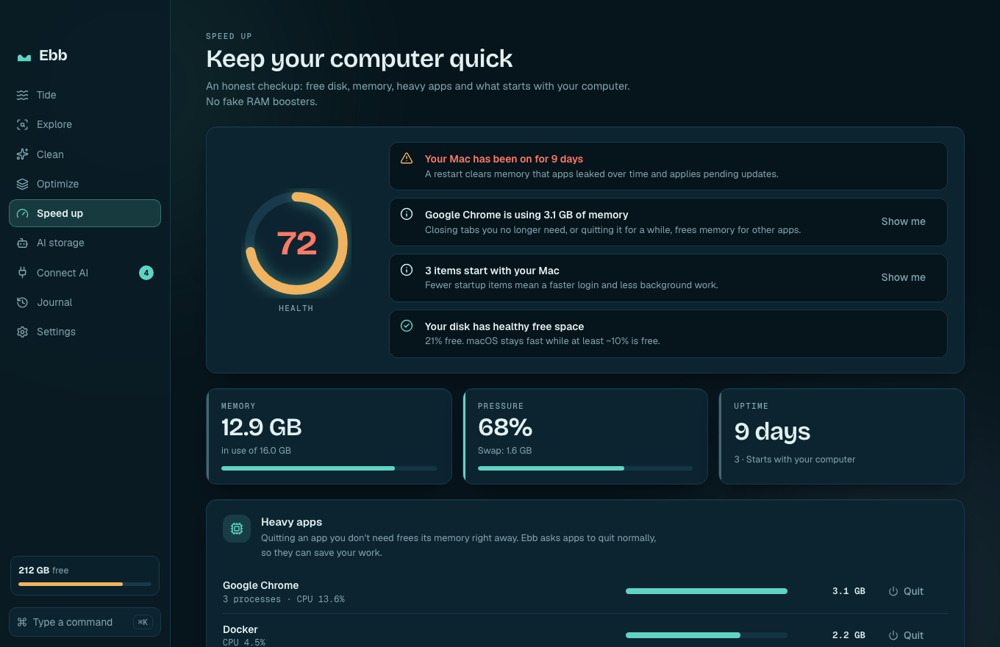

<p align="center">
  
</p>

<h1 align="center">Ebb</h1>

<p align="center">
  <b>See what fills your disk. Let the safe part go. Let your AI help, never delete.</b><br>
  Open source disk cleaner and AI-storage viewer for macOS, Windows and Linux.
</p>

<p align="center">
  <a href="https://github.com/ege-arhan/ebb/actions/workflows/ci.yml"></a>
  <a href="https://github.com/ege-arhan/ebb/releases/latest"></a>
  
  
  <a href="https://github.com/ege-arhan/ebb/stargazers"></a>
  <a href="https://github.com/ege-arhan/ebb/releases"></a>
</p>

<!-- Trendshift: Ebb gets an id once it appears on GitHub Trending. Replace ID below and remove this comment.
<p align="center"><a href="https://trendshift.io/repositories/ID" target="_blank"></a></p>
-->

<p align="center">
  
</p>
<p align="center">
  
  
  
</p>

## Why Ebb

- **A tide, not a dashboard.** The water is your used space; the pale band is the part Ebb can safely let go. It reacts to your pointer, and the water recedes when you clean.
- **Plan → review → apply → undo.** Nothing moves until you confirm a plan you can read. Everything goes to the Trash and the journal remembers it for 90 days.
- **Protected by default.** System folders, your home root, key stores, cloud-sync folders and git repos with uncommitted changes are never touched.
- **AI-native, but safe.** `ebb connect` wires Claude Code, Codex, Claude Desktop, LM Studio, Cursor, VS Code, Windsurf and Gemini CLI to a local MCP server in one step. Assistants can scan, explain and *plan*. They cannot delete, move or restore anything.
- **Knows what AI tools keep on disk.** Claude Code, Codex, Cursor, Ollama, LM Studio, Hugging Face caches and more.
- **Fast.** A 2-million-file home folder scans in ~16 s (3x faster than `du` on the same machine).
- **Smart Clean.** One screen finds every kind of reclaimable space (safe caches, old installers, idle project build folders, Trash) and shows a single plan you approve.
- **Type-aware compression.** Analyzes a folder by file type, estimates the real saving by sampling and compresses only what is worth it (skips PDFs, photos, video, archives).
- **Claude Code + Codex + local models, together.** The assistant can drive your installed `claude` and `codex` CLIs (read-only, plan-only) and compare their answers with a local model.
- **Space back, nothing deleted.** Duplicate copies become copy-on-write clones that share disk blocks (APFS, Btrfs, XFS), like Mint's Optimize. Folders you rarely open can be compressed in place (APFS, NTFS) and decompressed any time.
- **Finds the big stuff anywhere.** Large files you haven't opened in months, old installers in Downloads, plus 60+ cache recipes for browsers, dev tools, creative apps and the system.
- **Honest speed-up.** A health score with plain tips, memory pressure, the heaviest apps (quit them like Cmd+Q), and the items that start with your computer (turn them off and on). No fake RAM boosters.
- **A Trash you can see.** Everything Ebb cleans waits in the Trash first. Ebb shows what's there, restores its own items to where they came from, deletes selected items for good, or empties it, all from one screen.
- **Watch the trend.** A small chart shows how your free space changed over the last week or month.
- **Uninstall apps completely.** An app plus everything it left behind (support files, caches, preferences, containers) in one reviewed plan.
- **Developer cleanup.** Old `node_modules`, `target`, `.venv`, `Pods` in projects you haven't touched, plus the tools' own cleanups (Docker, Homebrew, Xcode simulators, npm, pnpm, pip…).
- **Auto Care.** Schedule cleanups. By default Ebb only prepares a plan and tells you; automatic apply is opt-in per rule.
- **Ask your disk.** Chat with a local model (Ollama or LM Studio). It can look and plan, never delete (`ebb ask`).
- **Auto-updates** from signed releases, and the UI speaks English, Türkçe, Deutsch, Español and Français.
- **Lives in your menu bar / tray.** Free space at a glance, quick actions, and closing the window keeps Ebb running.
- **Free, with no limits and no telemetry.** Apache-2.0. The only network call is an optional once-a-day check for a newer release on GitHub (turn it off in Settings).

## Install

Download from the [latest release](https://github.com/ege-arhan/ebb/releases/latest):

| Platform | File |
|---|---|
| macOS (Apple Silicon / Intel) | `Ebb_*_aarch64.dmg` / `Ebb_*_x64.dmg` |
| Windows | `Ebb_*_x64-setup.exe` (or the `.msi`) |
| Linux | `.AppImage`, `.deb` |
| Any, CLI only | `ebb-cli-*` archive |

The apps are **not code-signed yet**. On macOS, right-click the app → *Open* the first time (or run `xattr -dr com.apple.quarantine /Applications/Ebb.app`). On Windows, choose *More info → Run anyway* in SmartScreen.

**Package managers:** `brew install --cask ege-arhan/tap/ebb` on macOS. winget manifests are in `packaging/winget` (pending submission to the community repo).

## The CLI

```bash
ebb                    # dashboard: disk, what can ebb, AI storage
ebb clean              # pick what to clean (interactive), moves to the Trash
ebb scan ~/Projects    # where did the space go?
ebb why ~              # what grew since last time
ebb agents             # AI tools and local models on disk
ebb optimize           # win space back without deleting (clones duplicate copies)
ebb dupes ~/Downloads  # duplicate files
ebb compress ~/Archive # type-aware compression (--analyze, --all, --undo)
ebb big                # large forgotten files and old installers
ebb system             # health score, memory, heavy apps, tips
ebb apps --quit Slack  # quit an app gracefully
ebb startup            # items that start with your computer
ebb trash              # what's in the Trash (--restore <id>, --empty)
ebb uninstall Slack    # app + leftovers, reviewed
ebb projects           # rebuildable project folders
ebb prune              # Docker, Homebrew, pnpm… own cleanups
ebb care               # Auto Care rules
ebb ask "what grew?"   # local model, read + plan only
ebb connect            # connect your AI assistants
ebb undo <plan-id>     # restore a cleanup
ebb completions zsh    # shell completions
```

Every command takes `--json`. `ebb apply <id>` and non-interactive `ebb clean` need `--yes`.

## Connect your AI with one prompt

No terminal or code needed. Paste this into Claude, ChatGPT, Codex, Cursor, or any assistant that can run commands:

```text
Set up Ebb (an open-source disk cleaner) for me. Read https://raw.githubusercontent.com/ege-arhan/ebb/main/docs/AI-SETUP.md and follow it exactly: install the ebb CLI for my operating system, run `ebb connect --all`, confirm it worked, and tell me what to restart. Never run `ebb apply` or `ebb clean --yes`.
```

Prefer to do it yourself? One line:

```bash
curl -fsSL https://raw.githubusercontent.com/ege-arhan/ebb/main/install.sh | sh -s -- --connect     # macOS / Linux
irm https://raw.githubusercontent.com/ege-arhan/ebb/main/install.ps1 | iex; ebb connect --all       # Windows (PowerShell)
```

## Connect AI in one step

```bash
ebb connect            # detects Claude Code, Codex, Claude Desktop, LM Studio, Cursor, VS Code, Windsurf, Gemini CLI
ebb connect --list     # what was found and what is connected
ebb connect --remove cursor
```

`ebb connect` edits each client's own config atomically, keeps the first backup (`*.ebb-backup`), refuses symlinked or non-JSON configs, never overwrites a server called `ebb` it did not create, and finishes with a real self-test of the MCP server. The desktop app has the same flow on the **Connect AI** screen.

MCP tools: `ebb_scan`, `ebb_top`, `ebb_why`, `ebb_explain_path`, `ebb_findings`, `ebb_agents_storage`, `ebb_duplicates`, `ebb_large_old_files`, `ebb_system_health`, `ebb_folder_types`, `ebb_apps`, `ebb_uninstall_preview`, `ebb_project_artifacts`, `ebb_plan_cleanup`, `ebb_plan_status`. There is deliberately **no apply and no undo tool**: anything that moves files needs a human (`ebb apply --yes`, `ebb undo`, or the app).

## Build from source

```bash
pnpm -C apps/desktop install
node apps/desktop/scripts/sidecar.mjs debug      # builds the `ebb` CLI the app bundles
pnpm -C apps/desktop tauri dev                   # desktop app
pnpm -C apps/desktop dev                         # UI in a browser with mock data
cargo test --workspace
pnpm -C apps/desktop tauri build                 # installers for your OS
```

Layout: `crates/ebb-core` (scan, catalog, plan/journal, connect) · `crates/ebb-cli` · `crates/ebb-mcp` · `apps/desktop` (Tauri 2 + React) · `catalog/*.yaml` (cleanup recipes: add yours with a PR).

## Safety, reviewed

Two independent code reviews found 16 issues (protected-ancestor bypass, re-armed plans, symlink overwrites, MCP-triggered restore, concurrent config writes, …). All are fixed and pinned by tests in `crates/ebb-core/tests/review*.rs`. See [docs/ARCHITECTURE.md](docs/ARCHITECTURE.md) and [docs/reviews](docs/reviews). Windows and Linux builds are verified by CI only; real-device reports are very welcome.

## Star history

<a href="https://star-history.com/#ege-arhan/ebb&Date">
  <picture>
    <source media="(prefers-color-scheme: dark)" srcset="https://api.star-history.com/svg?repos=ege-arhan/ebb&type=Date&theme=dark">
    
  </picture>
</a>

If Ebb saved you some space, a ⭐ helps other people find it.

## License

Apache-2.0. See [LICENSE](LICENSE). Contributions: [CONTRIBUTING.md](CONTRIBUTING.md). Security: [SECURITY.md](SECURITY.md).
